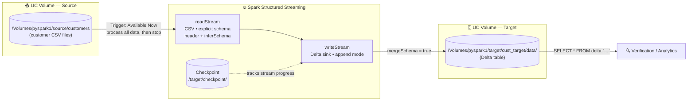
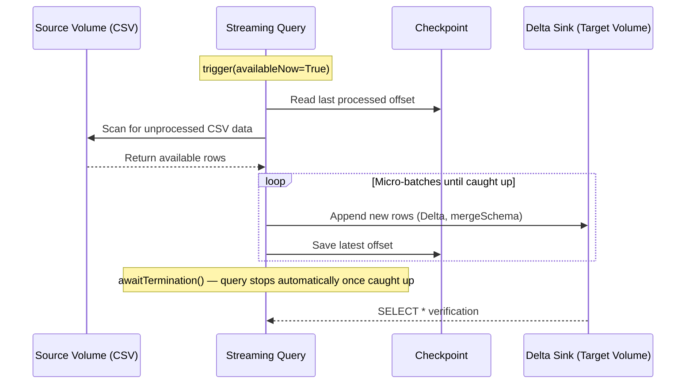

# ⚡ Spark Structured Streaming — CSV to Delta Lake Pipeline

A hands-on **Spark Structured Streaming** project built on **Databricks** that reads customer CSV files from a **Unity Catalog Volume**, processes them as a stream, and writes them into a **Delta Lake** sink using the **Available Now** trigger — combining streaming semantics with batch-style, run-to-completion execution.

---

## 📐 Architecture Overview



### The streaming flow at a glance

```
┌──────────────────────┐   ┌───────────────────────────┐   ┌───────────────────────────┐
│  📥 SOURCE            │   │  ⚡ STREAM PROCESSING      │   │  🗄️ SINK                   │
├──────────────────────┼───┼───────────────────────────┼───┼───────────────────────────┤
│ UC Volume            │──▶│ spark.readStream (CSV)    │──▶│ UC Volume (Delta format)   │
│ /Volumes/pyspark1/   │   │ .schema(my_schema)        │   │ /Volumes/pyspark1/target/ │
│ source/customers/    │   │ .trigger(availableNow=True)│   │ cust_target/data/         │
│ (customer CSVs)      │   │ .outputMode("append")     │   │ + checkpoint directory    │
└──────────────────────┘   └───────────────────────────┘   └───────────────────────────┘
```

---

## 📁 Project Structure

```
Spark-Structure-Streaming/
│
├── spark-structured-streaming.py    # The full streaming pipeline
│
├── Screenshots/                     # (add) Screenshots of pipeline runs & output
│   └── output-data.png               # (add) Query output screenshot referenced above
│
└── README/
    └── README.md                   # Project documentation (this file)
```

---

## ⚙️ What the Pipeline Does — `spark-structured-streaming.py`

### 1️⃣ Define the source schema

The customer CSV schema is declared explicitly so Spark doesn't have to guess:

| Column | Type | Description |
| --- | --- | --- |
| `Index` | int | Row number |
| `Customer_Id` | string | Unique customer identifier |
| `First_Name` | string | Customer first name |
| `Last_Name` | string | Customer last name |
| `Company` | string | Customer's company |
| `City` | string | Customer's city |
| `Country` | string | Customer's country |

### 2️⃣ Streaming read from the source volume

```python
df_rs = (spark.readStream.format("csv")
    .option("inferSchema", "True")
    .option("header", "True")
    .schema(my_schema)
    .load("/Volumes/pyspark1/source/customers"))
```

Reads the customer CSV files as an **unbounded streaming DataFrame**, backed by the explicit schema.

### 3️⃣ Streaming write to the Delta sink

```python
query = (df_rs.writeStream.format("delta")
    .option("checkPointLocation", "/Volumes/pyspark1/target/checkpoint/")
    .option("mergeSchema", "True")
    .outputMode("append")
    .trigger(availableNow=True)
    .start("/Volumes/pyspark1/target/cust_target/data/"))

query.awaitTermination()
```

Key streaming configurations:

| Option | Value | Purpose |
| --- | --- | --- |
| Format | `delta` | Writes the sink as a Delta Lake table |
| `checkPointLocation` | `/Volumes/pyspark1/target/checkpoint/` | Persists stream progress so re-runs resume exactly where they stopped — no duplicates, no data loss |
| `mergeSchema` | `True` | Evolves the Delta schema automatically if new columns appear |
| `outputMode` | `append` | Only new rows are added to the sink on each micro-batch |
| `trigger` | `availableNow=True` | **Available Now** — process everything currently available, then stop (batch-like run-to-completion) |

### 4️⃣ Verify the written data

After the stream completes, the Delta sink is queried directly to confirm the data landed:

```python
spark.sql("select * from delta.`/Volumes/pyspark1/target/cust_target/data/`").show(truncate=False)
```

### 5️⃣ Output Data (from the Delta sink)

<!-- 📷 SCREENSHOT PLACEHOLDER: upload your screenshot (e.g. to a `Screenshots/` folder in this repo)
     and keep the image path below in sync with the actual file name. -->


_Placeholder image — replace `../Screenshots/output-data.png` with your uploaded screenshot file._

Running the verification query against `/Volumes/pyspark1/target/cust_target/data/` returns **101 customer records**. First 10 rows:

| Index | Customer_Id | First_Name | Last_Name | Company | City | Country |
| --- | --- | --- | --- | --- | --- | --- |
| 1 | DD37Cf93aecA6Dc | Sheryl | Baxter | Rasmussen Group | East Leonard | Chile |
| 2 | 1Ef7b82A4CAAD10 | Preston | Lozano | Vega-Gentry | East Jimmychester | Djibouti |
| 3 | 6F94879bDAfE5a6 | Roy | Berry | Murillo-Perry | Isabelborough | Antigua and Barbuda |
| 4 | 5Cef8BFA16c5e3c | Linda | Olsen | Dominguez, Mcmillan and Donovan | Bensonview | Dominican Republic |
| 5 | 053d585Ab6b3159 | Joanna | Bender | Martin, Lang and Andrade | West Priscilla | Slovakia (Slovak Republic) |
| 6 | 2d08FB17EE273F4 | Aimee | Downs | Steele Group | Chavezborough | Bosnia and Herzegovina |
| 7 | EA4d384DfDbBf77 | Darren | Peck | Lester, Woodard and Mitchell | Lake Ana | Pitcairn Islands |
| 8 | 0e04AFde9f225dE | Brett | Mullen | Sanford, Davenport and Giles | Kimport | Bulgaria |
| 9 | C2dE4dEEc489ae0 | Sheryl | Meyers | Browning-Simon | Robersonstad | Cyprus |
| 10 | 8C2811a503C7c5a | Michelle | Gallagher | Beck-Hendrix | Elaineberg | Timor-Leste |

<details>
<summary>📷 Raw Spark <code>show()</code> output</summary>

```
+-----+---------------+----------+---------+-------------------------------+-----------------+--------------------------+
|Index|Customer_Id    |First_Name|Last_Name|Company                        |City             |Country                   |
+-----+---------------+----------+---------+-------------------------------+-----------------+--------------------------+
|1    |DD37Cf93aecA6Dc|Sheryl    |Baxter   |Rasmussen Group                |East Leonard     |Chile                     |
|2    |1Ef7b82A4CAAD10|Preston   |Lozano   |Vega-Gentry                    |East Jimmychester|Djibouti                  |
|3    |6F94879bDAfE5a6|Roy       |Berry    |Murillo-Perry                  |Isabelborough    |Antigua and Barbuda       |
|4    |5Cef8BFA16c5e3c|Linda     |Olsen    |Dominguez, Mcmillan and Donovan|Bensonview       |Dominican Republic        |
|5    |053d585Ab6b3159|Joanna    |Bender   |Martin, Lang and Andrade       |West Priscilla   |Slovakia (Slovak Republic)|
|6    |2d08FB17EE273F4|Aimee     |Downs    |Steele Group                   |Chavezborough    |Bosnia and Herzegovina    |
|7    |EA4d384DfDbBf77|Darren    |Peck     |Lester, Woodard and Mitchell   |Lake Ana         |Pitcairn Islands          |
|8    |0e04AFde9f225dE|Brett     |Mullen   |Sanford, Davenport and Giles   |Kimport          |Bulgaria                  |
|9    |C2dE4dEEc489ae0|Sheryl    |Meyers   |Browning-Simon                 |Robersonstad     |Cyprus                    |
|10   |8C2811a503C7c5a|Michelle  |Gallagher |Beck-Hendrix                  |Elaineberg       |Timor-Leste               |
+-----+---------------+----------+---------+-------------------------------+-----------------+--------------------------+
only showing top 10 rows
```

</details>

---

## 🔁 Execution Lifecycle



---

## 🧰 Tech Stack

| Component | Technology |
| --- | --- |
| Compute | 🔥 Databricks (PySpark) |
| Framework | ⚡ Spark Structured Streaming |
| Source | 📥 Unity Catalog Volume (CSV files) |
| Sink | 🗄️ Unity Catalog Volume (Delta Lake) |
| Trigger | 🕒 Available Now (run-to-completion) |
| Version Control | 🌿 Git (GitHub) |

---

## ▶️ How to Run

1. Ensure the source CSVs are present in `/Volumes/pyspark1/source/customers`.
2. Run `spark-structured-streaming.py` on a Databricks cluster.
3. The Available Now trigger processes all available data, writes it as Delta to `/Volumes/pyspark1/target/cust_target/data/`, and stops automatically.
4. The final cell verifies the loaded data with a `SELECT *` against the Delta sink.

> 💡 **Tip:** Re-run the script any time — the checkpoint location ensures only *new* data since the last run is processed, making this safe to schedule as a recurring incremental job.

---

## 🎯 Key Takeaways

* Demonstrates the core **Spark Structured Streaming** API: `readStream` → `writeStream` with checkpointing.
* Uses the **Available Now trigger** for exactly-once, batch-style incremental processing.
* Leverages **Unity Catalog Volumes** as both source and governed storage location.
* Writes to **Delta Lake** with `mergeSchema` for schema evolution and `append` output mode.
* Checkpoint-based offset tracking gives **fault-tolerance and idempotent re-runs**.